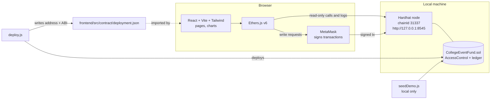
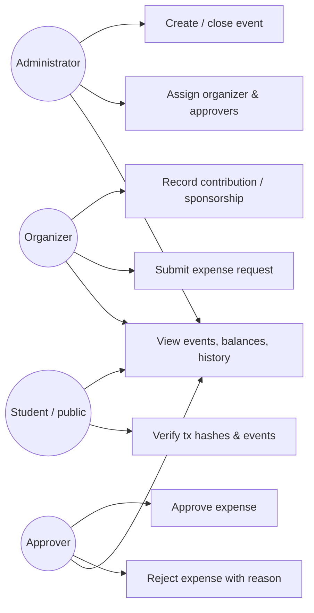
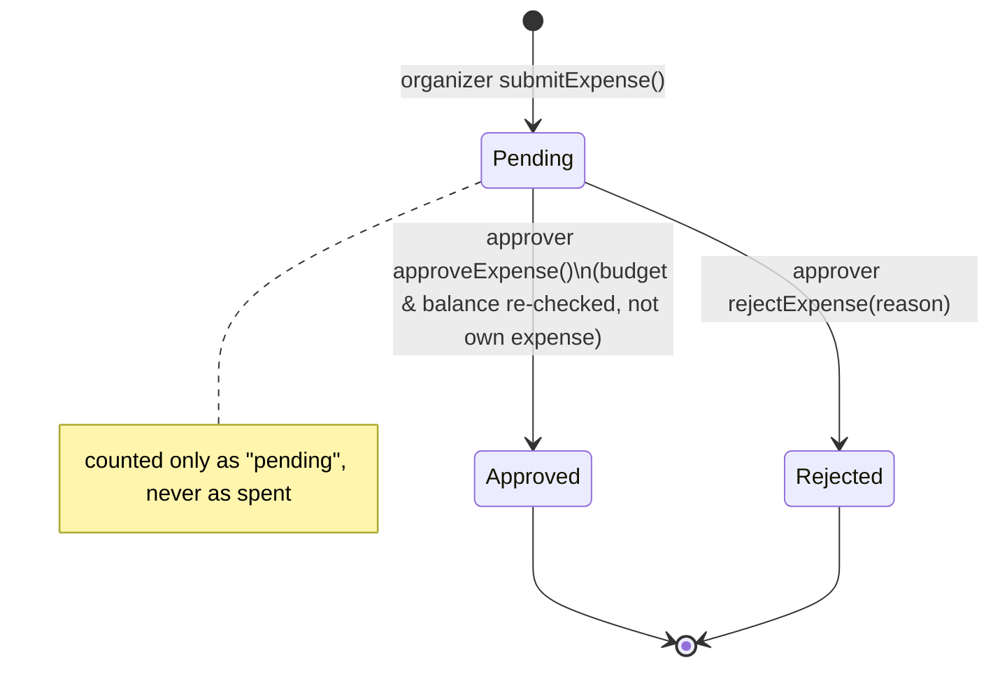

# Transparent College Event Fund Management DApp

> **Educational demonstration.** All amounts are *simulated INR ledger entries* on a local test blockchain.
> Nothing in this project moves real money, ETH or tokens, and a recorded contribution **does not prove** that a real payment happened.
> All sample data is fictional.

A college mini-project that uses an Ethereum-compatible smart contract (Solidity + Hardhat) and a React dashboard
(Vite, Tailwind, Recharts, Ethers.js, MetaMask) to keep a **tamper-evident, publicly verifiable record** of event contributions,
expense requests, approvals and balances.

## Table of contents
1. [Overview, problem statement, objectives](#1-overview)
2. [Features](#2-features) · [Technology stack](#3-technology-stack)
3. [Architecture & diagrams](#4-architecture-and-diagrams)
4. [Roles & permissions](#5-roles-and-permissions)
5. [Smart-contract reference](#6-smart-contract-reference)
6. [Folder structure](#7-folder-structure)
7. [Setup & run](#8-setup-and-run) (prerequisites → install → node → deploy → seed → frontend → MetaMask)
8. [Demo walkthrough](#9-demo-walkthrough)
9. [Testing & actual results](#10-testing-and-actual-results)
10. [Troubleshooting](#11-troubleshooting) · [Known limitations](#12-known-limitations) · [Future enhancements](#13-future-enhancements)

Report-ready **abstract and conclusion**: [`docs/REPORT.md`](docs/REPORT.md).

---

## 1. Overview

**Problem.** College event money (student contributions, sponsorships, spending) is usually tracked in spreadsheets or notebooks held by a few
organizers. Records can be edited after the fact, approvals are informal, and students have no easy way to verify where funds went.

**Solution.** Every contribution entry, expense request, approval and rejection is written to a smart contract. Entries are append-only, signed
by the wallet that made them, time-stamped by the block, and emitted as events that anyone can inspect. Role rules (who may record, submit, approve)
are enforced **inside the contract**, not just the UI.

**Objectives**
- Multiple independent events, each with a budget and fundraising target.
- Role-based access control: administrator, organizer, approver, public viewer.
- Expense workflow with mandatory approval and mandatory rejection reasons.
- Contract-computed totals: contributions, approved / pending / rejected expenses, remaining balance, budget utilization, funding progress.
- A transparent, chronological history with real transaction hashes.
- Fully reproducible on a laptop with no paid services.

## 2. Features
- Event creation/closing, organizer reassignment (admin).
- Contribution & sponsorship ledger entries with unique references (duplicates rejected).
- Expense submission → Pending → Approved / Rejected (reason required). No double processing.
- Approval policy re-checked at approval time (see below). Separation of duties: nobody reviews their own submission.
- Dashboard with charts, event cards, event detail pages with activity feed, searchable history with transaction-detail view.
- MetaMask integration: connect/disconnect, account & network change detection, one-click add/switch to the local network, tx status banner, readable error messages.

**Currency convention.** All amounts are integers in **INR rupees** (1 unit = ₹1). No decimals, no floating point, no ETH↔INR conversion.
Percentages are returned in **basis points** (10000 = 100 %); the UI formats them.

**Approval policy** (checked inside `approveExpense`, on cumulative totals):
```
totalApproved + amount <= event.budget
totalApproved + amount <= totalContributions      (available recorded balance)
```
Pending and rejected expenses never count as spent. A zero budget therefore allows no approvals. A zero target/budget gives 0 % (no division by zero).
An event cannot be closed while expenses are pending; a closed event rejects contributions, submissions and reviews.

## 3. Technology stack
| Layer | Choice | Version used |
|---|---|---|
| Contracts | Solidity, OpenZeppelin `AccessControl` | solc 0.8.28, OZ 5.4.0 |
| Tooling | Hardhat + `hardhat-toolbox` (Mocha, Chai, ethers v6) | Hardhat 2.29.1 |
| Frontend | React 18, Vite 5, Tailwind CSS 3, React Router 6, Recharts 2, Lucide React | see `frontend/package.json` |
| Chain access | Ethers.js | 6.15 (frontend) |
| Wallet | MetaMask (EIP-1193) | — |
| Runtime | Node.js, npm | developed on Node 22; Node 20 LTS expected to work (not tested here) |

No centralized backend. The frontend reads public data directly from the local RPC node and signs writes with MetaMask.

## 4. Architecture and diagrams

### System architecture


### Use-case diagram


### Expense approval workflow


## 5. Roles and permissions
Enforced in Solidity (`onlyRole`, per-event organizer checks, custom errors). The UI only *hides* what the contract would reject anyway.

| Capability | Administrator | Event organizer | Approver | Student / public |
|---|:--:|:--:|:--:|:--:|
| Create / close event, reassign organizer | ✅ | – | – | – |
| Grant / revoke approver role | ✅ | – | – | – |
| Record contribution (own events only) | – | ✅ | – | – |
| Submit expense (own events only) | – | ✅ | – | – |
| Approve / reject expense (not own) | – | – | ✅ | – |
| Read events, totals, ledger, history | ✅ | ✅ | ✅ | ✅ |

*Design choices:* the administrator can manage events/roles but cannot write ledger entries (separation of duties); the organizer role is assigned per event when it is created.
`DEFAULT_ADMIN_ROLE` is the college administrator account (the deployer).

## 6. Smart-contract reference
`contracts/CollegeEventFund.sol`

**Write functions**
| Function | Who | Purpose |
|---|---|---|
| `createEvent(id, name, description, metadata, budget, target, organizer)` | admin | New event (unique non-zero id) |
| `setEventOrganizer(eventId, newOrganizer)` | admin | Reassign organizer of an active event |
| `closeEvent(eventId)` | admin | Close; blocked while expenses pending |
| `recordContribution(eventId, contributor, label, amount, kind, refId)` | event organizer | Append ledger entry; `refId` globally unique |
| `submitExpense(eventId, category, description, amount, receiptRef)` | event organizer | Creates Pending expense |
| `approveExpense(expenseId)` | approver | Pending → Approved (limits rechecked) |
| `rejectExpense(expenseId, reason)` | approver | Pending → Rejected (reason required) |
| `grantRole / revokeRole` (OpenZeppelin) | admin | Manage `APPROVER_ROLE` |

**Read functions (public):** `getEventCount`, `getEventIds`, `getFundEvent`, `eventExists`, `getSummary`, `getContributionCount`, `getContribution`,
`getEventContributionIds`, `getExpenseCount`, `getExpense`, `getEventExpenseIds`, `isReferenceUsed`.
(`getFundEvent` is deliberately not called `getEvent`, which collides with a built-in method of ethers v6 contract objects.)

**Events:** `EventCreated`, `EventClosed`, `OrganizerChanged`, `ContributionRecorded`, `ExpenseSubmitted`, `ExpenseApproved`, `ExpenseRejected` (+ OpenZeppelin `RoleGranted`/`RoleRevoked`).

**Custom errors:** `EventAlreadyExists`, `EventNotFound`, `EventNotActive`, `ExpenseNotFound`, `ContributionNotFound`, `InvalidEventId`, `InvalidAddress`, `InvalidAmount`,
`InvalidText`, `NotEventOrganizer`, `DuplicateReference`, `ExpenseNotPending`, `SelfApprovalNotAllowed`, `ExceedsBudget`, `ExceedsAvailableBalance`, `PendingExpensesExist`
(+ OpenZeppelin `AccessControlUnauthorizedAccount`).

## 7. Folder structure
```
college-event-fund-dapp/
├── contracts/CollegeEventFund.sol
├── scripts/
│   ├── deploy.js            # deploys + writes frontend/src/contract/deployment.json
│   └── seedDemo.js          # FICTIONAL demo data, refuses to run unless chainId == 31337
├── test/CollegeEventFund.test.js
├── frontend/
│   ├── index.html, vite.config.js, tailwind.config.js, postcss.config.js
│   └── src/
│       ├── main.jsx, App.jsx, index.css
│       ├── components/      # Layout, UI kit, Gate (permission gate)
│       ├── hooks/           # useWeb3 (wallet), useFundData (chain data), useTx (tx runner)
│       ├── lib/             # config.js, format.js, errors.js (revert → friendly text)
│       ├── pages/           # Landing, Dashboard, Events, EventDetails, CreateEvent,
│       │                    # Contributions, ExpenseSubmit, Approvals, History, Roles
│       └── contract/        # deployment.json is GENERATED here by `npm run deploy`
├── docs/REPORT.md           # abstract & conclusion
├── hardhat.config.js
├── package.json
└── README.md
```
`deployment.json` structure: `{ contractName, network, chainId, address, admin, deployTxHash, deployBlock, abi }`. Both `deploy.js` and the frontend use this single file; the address is never hard-coded.

## 8. Setup and run

### Prerequisites
- Node.js 20 or 22 LTS and npm, VS Code (optional), the **MetaMask** browser extension.
- Internet access for `npm install` (and for Hardhat to download the Solidity compiler on first compile).

### Install
```bash
cd college-event-fund-dapp
npm install                    # Hardhat, OpenZeppelin, tests
npm run frontend:install       # React app dependencies
```
No `.env` file is needed: everything runs on the local network. (Never put real private keys in this project.)

### Compile & test
```bash
npx hardhat compile
npm test
```
> If your network blocks Hardhat's compiler download, `hardhat.config.js` automatically falls back to the pure-JS compiler from the `solc` npm package
> (same version). Force it with `USE_SOLCJS=1 npm test` (Windows PowerShell: `$env:USE_SOLCJS=1; npm test`).

### Run the local blockchain, deploy, seed, start the UI
Use **three terminals** in the project root:
```bash
# Terminal 1 - local blockchain (keep running; prints 20 test accounts + private keys)
npm run node

# Terminal 2 - deploy, then (optionally) seed fictional demo data
npm run deploy      # writes frontend/src/contract/deployment.json
npm run seed        # 3 fictional events; local network only

# Terminal 3 - frontend
npm run frontend    # http://localhost:5173
```
> The local chain is **in-memory**. If you restart `npm run node`, run `npm run deploy` (and `npm run seed`) again, then reset MetaMask's account activity (see Troubleshooting).

### MetaMask local-network configuration
1. MetaMask → network picker → *Add a custom network* (or just click **Connect Wallet** in the app and approve the prompt):
   - Network name: `Hardhat Local` · RPC URL: `http://127.0.0.1:8545` · Chain ID: `31337` · Currency symbol: `ETH`
2. Import test accounts: MetaMask → *Import account* → paste a private key printed by `npm run node`.
   These keys are **public** – use them only on this local network.
3. Seed script role assignment (Hardhat default account order):

| Account | Role in demo |
|---|---|
| #0 | Administrator (deployer) |
| #1, #2 | Approvers |
| #3 | Organizer – Annual Cultural Fest |
| #4 | Organizer – Technical Symposium |
| #5 | Organizer – Sports Day |
| #6 and up | Students / public viewers |

## 9. Demo walkthrough
After `deploy` + `seed`, the data already shows: a fully approved expense, a pending expense, a rejected expense (with reason), an event with ample remaining funds
(Cultural Fest: ₹85,000 left) and an event close to its budget limit (Sports Day: 91.7 % used, ₹3,000 left).

1. **Public view** – open the app with no wallet: Dashboard, Events, History work for everyone.
2. **Organizer** – switch MetaMask to account #4 → *Contributions*: record a contribution (unique reference) → dashboard totals update after confirmation.
3. **Organizer** – *Submit Expense* → note the returned expense ID; it appears as Pending.
4. **Approver** – switch to account #1 → *Approvals*: approve, or reject with a reason (confirmation dialogs appear).
5. **Everyone** – *Event details* and *History* show the activity feed, current statuses and tx hashes; click a hash for block/gas/from/to read from the local node.
6. **Try to break it** – as a student open *Approvals*; or as approver try approving an expense larger than the remaining balance. The contract refuses and the UI shows why.

## 10. Testing and actual results
Run: `npm test` (Hardhat + Mocha + Chai). **Result of the final run in the development environment: 22 passing, 0 failing** (Hardhat 2.29.1, solc 0.8.28 via solc-js, Node 22).

| # | Required scenario | Test | Actual result |
|---|---|---|---|
| T1 | Admin creates event | `[T1] administrator successfully creates an event` | ✅ pass |
| T2 | Unauthorized cannot create | `[T2] unauthorized users cannot create events` | ✅ pass |
| T3 | Duplicate event IDs rejected | `[T3] duplicate event IDs are rejected` | ✅ pass |
| T4 | Organizer records contributions | `[T4] authorized organizer can record contributions…` | ✅ pass |
| T5 | Invalid/unauthorized contributions rejected | `[T5] invalid or unauthorized contributions are rejected` | ✅ pass |
| T6 | Organizer submits expense | `[T6] organizers can submit expense requests` | ✅ pass |
| T7 | Approver approves | `[T7] approver can approve a valid expense` | ✅ pass |
| T8 | Approver rejects with reason | `[T8] approver can reject an expense with a reason…` | ✅ pass |
| T9 | Unauthorized cannot approve/reject | `[T9] unauthorized users cannot approve or reject expenses` | ✅ pass |
| T10 | No double processing | `[T10] an expense cannot be approved or rejected twice` | ✅ pass |
| T11 | Pending/rejected excluded from spend | `[T11] pending and rejected expenses are excluded…` | ✅ pass |
| T12 | Remaining balance correct | `[T12] remaining balance updates correctly after approvals` | ✅ pass |
| T13 | Budget / balance limit enforced | `[T13] approval is blocked when it would exceed budget or available balance` | ✅ pass |
| T14 | Multi-event totals | `[T14] financial totals remain correct and independent…` | ✅ pass |
| T15 | Closed events reject operations | `[T15] closed events reject contributions, expenses and reviews…` | ✅ pass |
| T16 | Zero budget/target safe | `[T16] zero budget / zero target do not cause division errors` | ✅ pass |
| T17 | Events emitted | `[T17] important smart-contract events are emitted…` (plus `.to.emit` checks in T1, T4, T6–T8, T15) | ✅ pass |
| T18 | Reverts leave state unchanged | `[T18] reverted transactions leave financial state unchanged` | ✅ pass |
| – | Extras | invalid event inputs · invalid expense inputs · self-approval blocked · public views/unknown IDs | ✅ pass (4) |

**Additional verification performed during development** (not part of `npm test`, results not saved as logs):
- Contract reads, event-log parsing and the activity feed were checked against a live local node with seeded data; per-event totals matched hand-computed values.
- A throw-away jsdom harness rendered the real React app against the live node with a mock `window.ethereum` forwarding to the Hardhat node's unlocked accounts. 8/8 scenarios passed on a clean seeded chain
  (public dashboard totals vs. on-chain totals, events filter, event details, history search + tx details, approver approve, approver reject with required reason,
  organizer expense submission returning the expense ID, student permission gating, admin event creation with validation).
  **This is not a substitute for a real browser + MetaMask session**, which was not available in the development sandbox (see Known limitations). The harness was not kept in the repo.

## 11. Troubleshooting
| Symptom | Cause / fix |
|---|---|
| UI banner: *Contract not deployed* | `frontend/src/contract/deployment.json` missing → run `npm run deploy` with the node running, reload. |
| *No contract found at the deployed address* | Hardhat node was restarted (in-memory chain). Re-run `npm run deploy` (+ `seed`). |
| *Cannot reach the local blockchain* | Start `npm run node`; ensure port 8545 is free. |
| MetaMask shows *Wrong network* | Click the red badge to switch/add `Hardhat Local` (chain 31337). |
| Transactions hang / "nonce too high" after restarting the node | MetaMask → Settings → Advanced → **Clear activity tab data** (resets cached nonces). |
| "Your wallet does not have the required role" | You are on the wrong account. Switch to the account in the role table above. |
| Compiler download error | Use the automatic fallback or `USE_SOLCJS=1` (see Setup). |
| `npm audit` reports vulnerabilities | They come from development tooling (Hardhat toolbox, Vite) used only locally; not part of the deployed contract. Do not run `npm audit fix --force` blindly. |
| Seed refuses to run | By design: it only runs when chain ID is 31337. |

## 12. Known limitations
- **Simulated ledger:** contributions/expenses are records, not payments. The contract cannot verify that real money moved; honest organizers and real receipts are still needed. Receipt references are strings (e.g. invoice number or an IPFS CID); files are not stored or verified.
- **Trusted roles:** the administrator can grant approver rights and create events. Collusion between an organizer and an approver is possible. A single admin key is a single point of failure (no multi-sig or timelock).
- **Privacy:** everything on-chain is public and permanent. Use pseudonymous labels; never enter personal data. Event metadata is public too.
- **Scale:** the dashboard loads all records and event logs and polls every 10 s – fine for a demo, not for thousands of entries (would need an indexer/subgraph and pagination).
- **Numbers:** the UI converts amounts to JavaScript numbers (safe up to ~9×10¹⁵ rupees).
- **Local only:** deployed and tested only on the Hardhat local network. Not audited. Do not deploy to a public network without a professional review.
- **Testing gaps:** no automated browser/MetaMask end-to-end test is included; the real-wallet flow should be exercised manually (section 9). No gas or performance measurements were taken.
- Wallet "Disconnect" only clears this app's session; MetaMask cannot be disconnected programmatically.

## 13. Future enhancements
IPFS receipt storage with hash anchoring · multi-signature or threshold approvals · optional on-chain fund custody (e.g. a stablecoin escrow, separate from the INR ledger) ·
event indexer/subgraph with pagination · CSV/PDF audit export · deployment to a public testnet (Sepolia) · wallet-signed student receipts for contributions · UI automated tests (Playwright).

## License
MIT – educational use.
